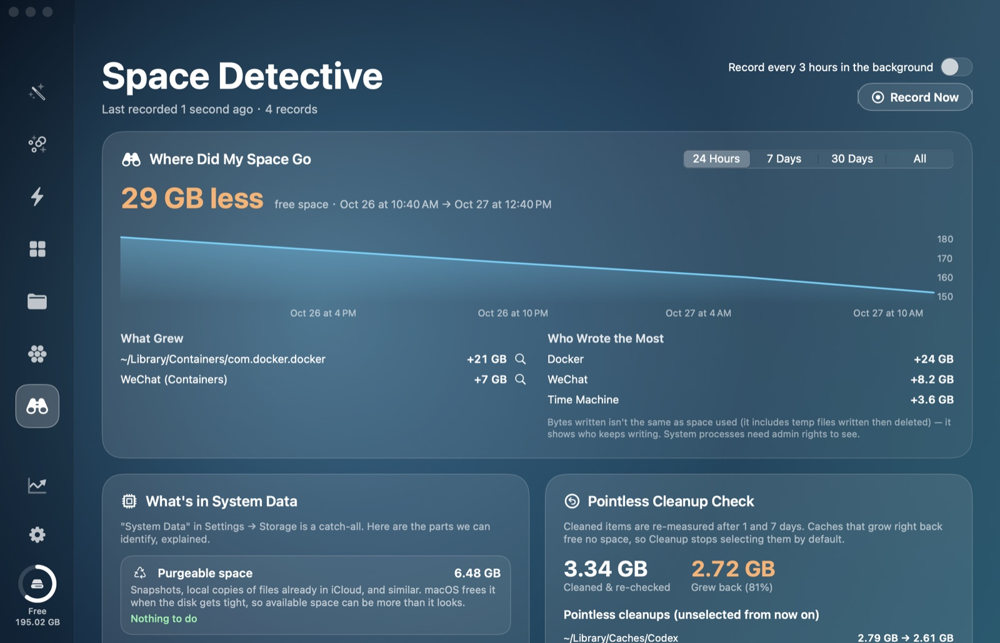
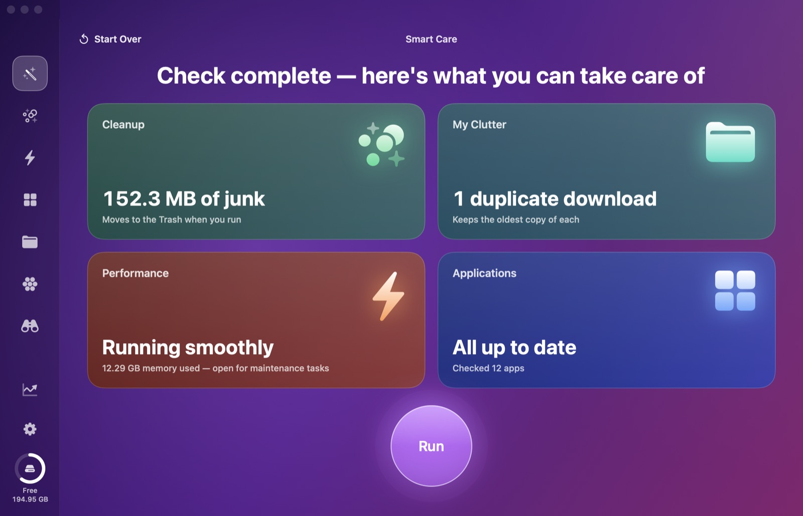
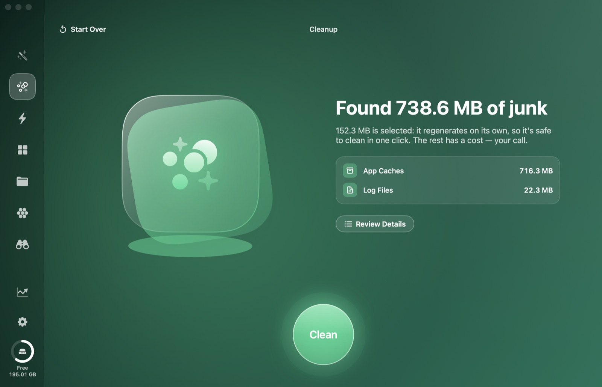
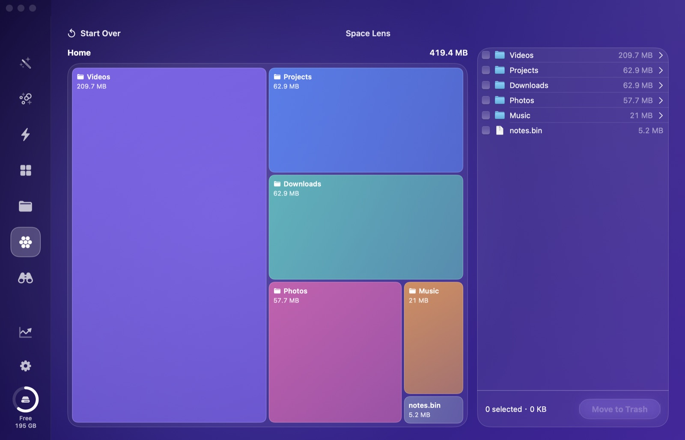
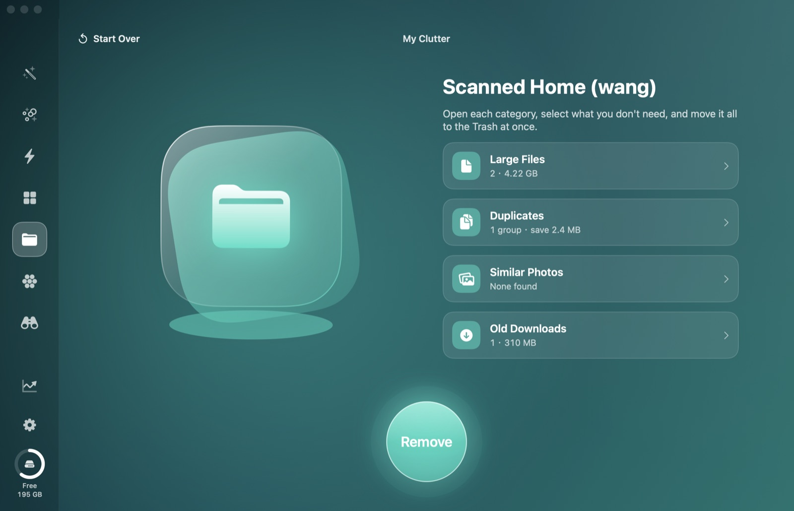
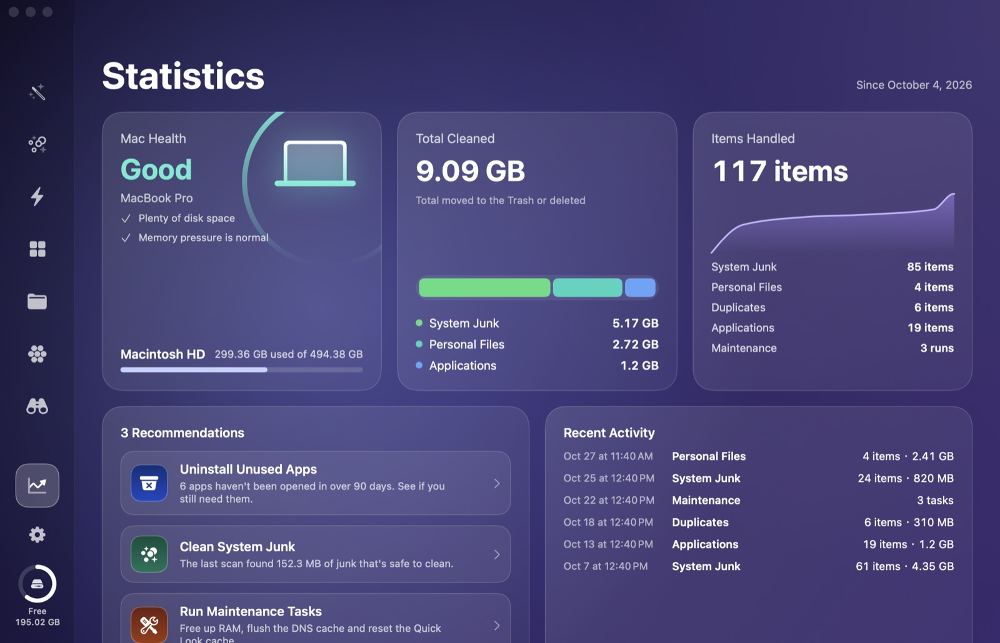

# SafeClean for Mac

**English** · [简体中文](README.zh-CN.md)

A free, open-source Mac cleaner written in SwiftUI. Clean junk, uninstall apps completely, find duplicates, and see exactly where your disk space went. Everything goes to the Trash first, so nothing is ever lost by accident.

**[⬇️ Download the latest release](https://github.com/thomaswang0916/safeclean-mac/releases/latest)** · **[▶️ Watch the 1-minute demo](https://github.com/thomaswang0916/safeclean-mac/releases/latest/download/SafeClean-demo-en.mp4)**



## Space Detective: answers to the most common Mac storage questions

- **"I lost 40 GB overnight. What took it?"** SafeClean records free space, the size of key locations and **how much each app has written to disk**. It tells you things like "29 GB less in the last 24 hours: Docker grew 21 GB, WeChat wrote 8 GB." Optional background recording runs every 3 hours at low priority and never goes online.
- **"Why is System Data so big?"** It breaks down the "System Data" bar in Settings → Storage: local snapshots, a downloaded macOS update waiting to install, swap, the sleep image, crash dumps, system asset downloads, temp files, Docker's virtual disk, simulators and the Spotlight index. Each item explains whether it's safe to touch and how.
- **"Do cleaners even help?"** Cleaned items are re-measured after 1 and 7 days. Caches that grow right back (cleaning them frees nothing) are flagged and no longer selected by default.



## Features

| Module | What it does |
| --- | --- |
| Smart Care | One scan for junk, duplicate downloads, performance and app updates, summarized on a dashboard. "Run" only cleans what's selected by default. |
| Cleanup | App caches (including sandbox containers), logs, Electron and developer caches, Xcode junk, broken launch agents, damaged preferences, chat app caches, local AI models, Trash |
| Performance | Maintenance tasks (free up RAM, flush DNS, reindex Spotlight, rebuild "Open With", reset Quick Look), background item switches, heavy consumers |
| Applications | Complete uninstall (login items, extensions, App Groups, launch agents and other leftovers) and update checks (Sparkle appcasts and the App Store) |
| My Clutter | Large files, duplicates (content hash), similar photos (Apple Vision feature prints), downloads older than 30 days |
| Space Lens | A treemap of what's taking space. Drill into folders, select, move to Trash. |
| Space Detective | Space change tracking with per-app attribution, System Data breakdown, pointless-cleanup detection |
| Statistics | Mac health, total cleaned, history and recommendations (such as apps unopened for 90+ days) |

| | |
| --- | --- |
|  |  |
|  |  |

The interface is in English by default. Switch to Simplified Chinese in **Settings (⌘,)**.

## Safety by design

- Everything is **moved to the Trash**, except the Trash category itself (which asks again and is never selected by default)
- Only things that regenerate on their own are selected by default. Anything with a cost (caches of running apps, browser engines, chat caches, AI models, iOS backups) stays unselected, with an explanation of what happens if you delete it
- Duplicate detection skips Git repositories, dependency and build folders, and video-editor libraries, and always keeps the oldest copy
- Apps must be quit before uninstalling; App Groups shared with other apps stay unselected
- Maintenance tasks that need admin rights use the macOS password prompt. SafeClean never sees your password
- Space Detective data stays on your Mac in `~/Library/Application Support/SafeClean/`. Background recording is off by default and turning it off removes its launch agent
- Nothing is uploaded. The only network access is checking for app updates (the Sparkle feeds apps declare, and Apple's public App Store lookup)

## Install

**Download:** grab `SafeClean.zip` from the [latest release](https://github.com/thomaswang0916/safeclean-mac/releases/latest), unzip it and move `SafeClean.app` to Applications. Runs on macOS 14 or later, on Apple silicon and Intel.

The app isn't notarized by Apple, so macOS blocks it the first time. Right-click `SafeClean.app` and choose **Open**. On macOS 15 or later, try to open it once, then go to System Settings → Privacy & Security and click **Open Anyway**.

To scan the Trash, Mail attachments and iOS backups, add `SafeClean.app` under System Settings → Privacy & Security → **Full Disk Access** (the banner at the top of the app links straight there).

**Build from source** (needs the Xcode Command Line Tools: `xcode-select --install`):

```bash
git clone https://github.com/thomaswang0916/safeclean-mac.git
cd safeclean-mac
./build.sh
open SafeClean.app
```

`build.sh` signs ad hoc by default, so macOS treats every rebuild as a new app and asks for permissions again. To avoid that, create a self-signed code-signing certificate named **SafeClean Local Signing** in Keychain Access (Certificate Assistant → Create a Certificate, type "Code Signing"), or pass any identity via `SIGN_IDENTITY`. Set `UNIVERSAL=1` to build for both Apple silicon and Intel.

## Command line

```bash
# Read-only self-test: lists every junk category with counts and sizes, deletes nothing
SafeClean.app/Contents/MacOS/SafeClean --selftest

# Take one Space Detective snapshot (what background recording runs)
SafeClean.app/Contents/MacOS/SafeClean --snapshot

# Put something back from the Trash (only accepts paths inside ~/.Trash, never overwrites)
SafeClean.app/Contents/MacOS/SafeClean --put-back ~/.Trash/some-file ~/original/location/some-file
```

## Notes

The layout takes inspiration from CleanMyMac (an icon rail, a gradient per module, a round action button). All artwork is drawn with SF Symbols and gradients. This project is not affiliated with MacPaw or CleanMyMac.

Not included: malware scanning (it needs a professional malware database), cloud storage cleanup, a menu bar app.

## License

[MIT](LICENSE)
