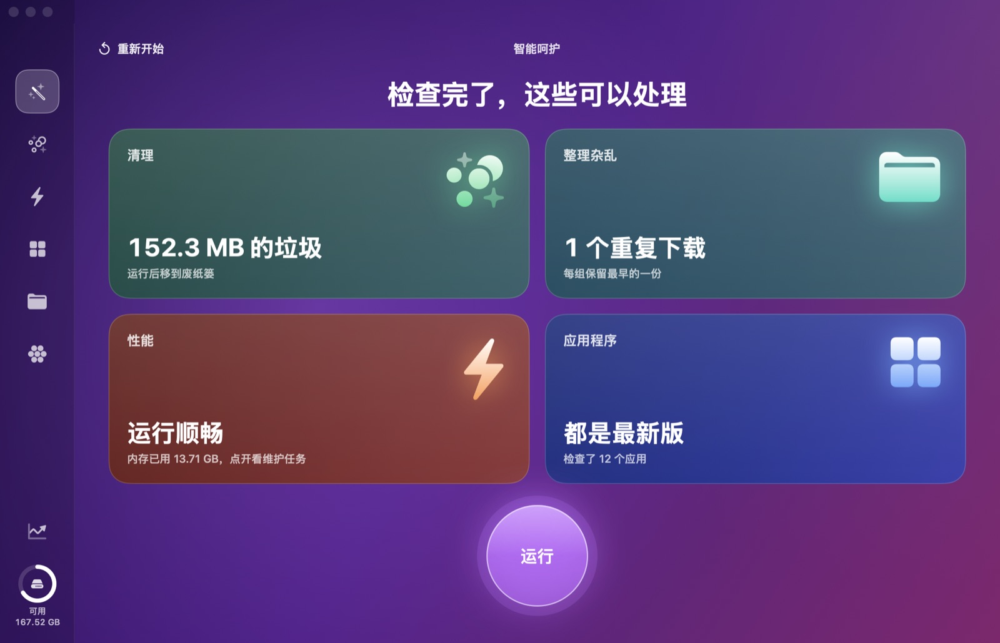
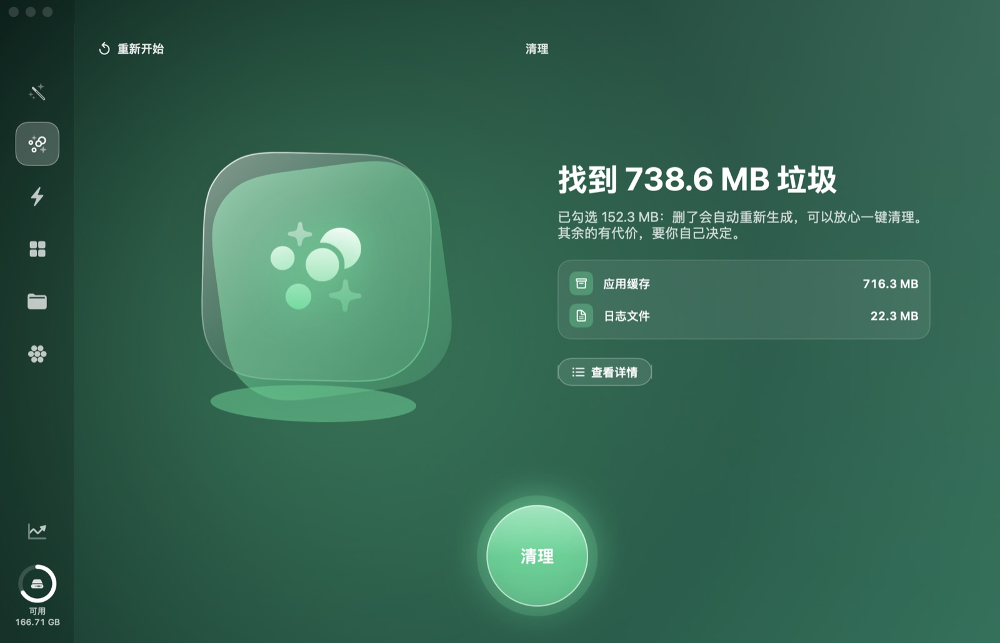
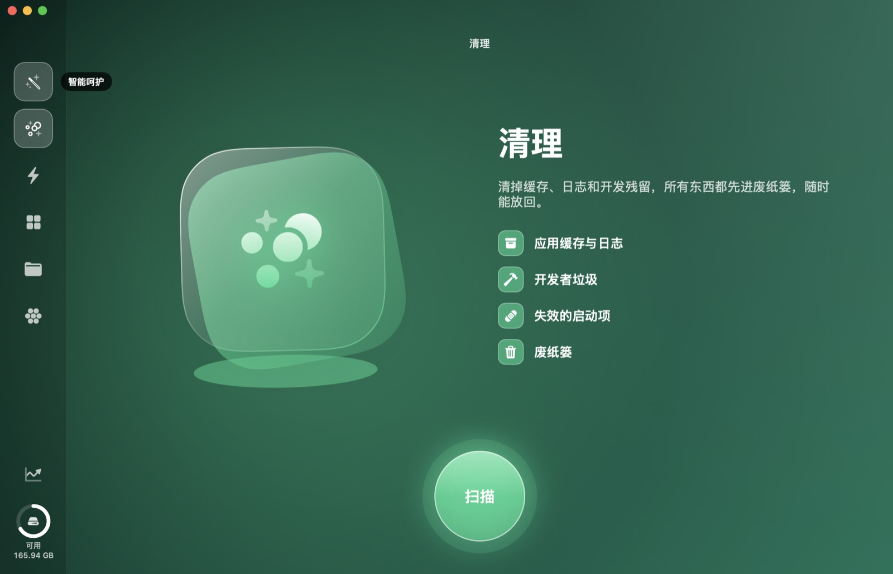
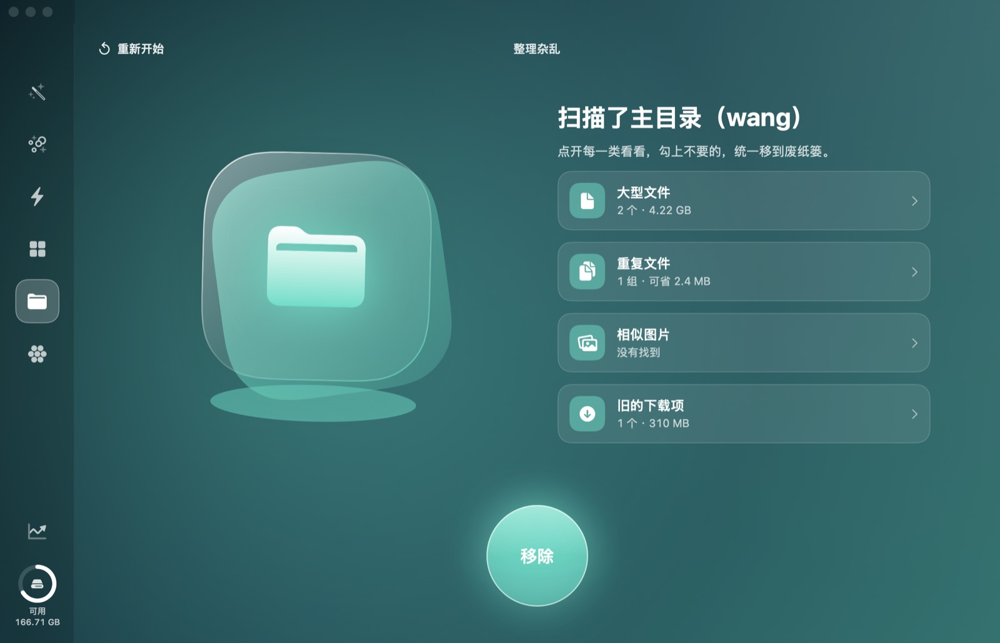
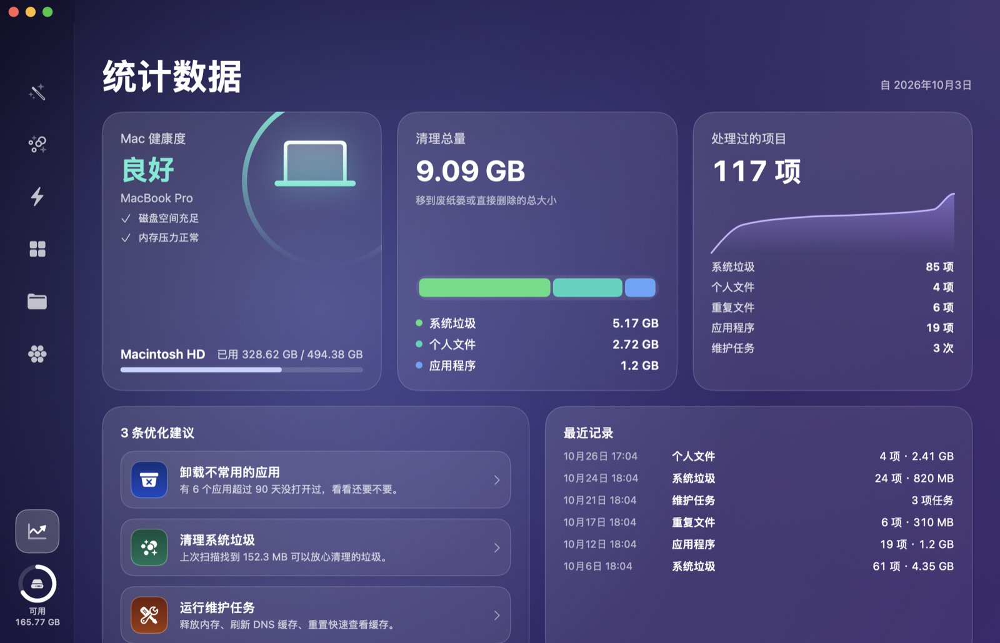

# 放心清理 · SafeClean for Mac

一个原生 SwiftUI 写的 macOS 清理工具：清垃圾、卸载应用、找重复文件、看磁盘空间被谁占了。所有删除默认都先移到废纸篓，随时能放回。

A native SwiftUI Mac cleaner — junk cleanup, app uninstaller, duplicate finder, disk space map. Everything goes to the Trash first, so it's always recoverable.



## 功能

| 模块 | 做什么 |
| --- | --- |
| 智能呵护 | 一次扫描清理、重复下载、性能和应用更新，仪表盘汇总；“运行”只清理默认勾选的垃圾和重复下载的副本 |
| 清理 | 应用缓存（含沙盒容器）、日志、Electron 和开发工具缓存、Xcode 垃圾、失效启动项、损坏的偏好设置、聊天软件缓存、本地 AI 模型、废纸篓 |
| 性能 | 维护任务（释放内存、刷新 DNS、重建 Spotlight 和“打开方式”、重置快速查看）、后台启动项开关、高耗能应用 |
| 应用程序 | 彻底卸载（含登录项、扩展、App Group、启动代理等残留）、检查更新（Sparkle appcast 和 App Store） |
| 整理杂乱 | 大文件、重复文件（内容哈希）、相似图片（系统 Vision 图像特征）、30 天以上的旧下载 |
| 空间透镜 | 方块图显示空间分布，点文件夹逐层进入，勾选后移到废纸篓 |
| 统计数据 | Mac 健康度、累计清理量、处理记录、优化建议（比如 90 天没打开的应用） |

| | |
| --- | --- |
|  |  |
|  |  |

## 安全设计

- 除了“废纸篓”这一类（会二次确认、默认不勾），所有清理都是**移到废纸篓**
- 默认只勾选删了也会自动重新生成的东西；有代价的（正在运行的应用的缓存、浏览器内核、聊天缓存、AI 模型、iOS 备份）默认不勾，并写明删了会怎样
- 重复文件跳过 Git 仓库、依赖和构建目录、剪辑软件素材库，每组保留最早的一份
- 卸载前要求先退出应用；和别的应用共享的 App Group 默认不勾
- 需要管理员权限的维护任务用 macOS 自己的密码框，应用拿不到密码
- 不联网上传任何数据；联网只用于检查应用更新（读取应用自己声明的 Sparkle 更新源和 App Store 公开接口）

## 安装和编译

需要 macOS 14 以上、Xcode 命令行工具（`xcode-select --install`）。

```bash
git clone https://github.com/thomaswang0916/safeclean-mac.git
cd safeclean-mac
./build.sh
open SafeClean.app
```

首次打开如果被系统拦截，右键 `SafeClean.app` 选“打开”。

想扫描废纸篓、邮件附件、iOS 备份，需要在「系统设置 → 隐私与安全性 → 完全磁盘访问权限」里加入 `SafeClean.app`（应用顶部的“去设置”按钮会直接跳过去）。

### 签名小技巧

`build.sh` 默认用临时签名，这样每次重新编译后系统会把它当成新应用，需要重新授权。想避免这个问题，可以在钥匙串里建一个名为 **SafeClean Local Signing** 的自签名代码签名证书（钥匙串访问 → 证书助理 → 创建证书，类型选“代码签名”），`build.sh` 会自动用它签名。也可以用 `SIGN_IDENTITY` 环境变量指定其他证书。

## 命令行

```bash
# 只读自检：列出每类垃圾的数量和大小，不删除任何东西
SafeClean.app/Contents/MacOS/SafeClean --selftest

# 把东西从废纸篓放回原处（只接受废纸篓里的路径，原位置已有东西时拒绝）
SafeClean.app/Contents/MacOS/SafeClean --put-back ~/.Trash/某个文件 ~/原来的位置/某个文件
```

## 说明

界面布局参考了 CleanMyMac 的设计思路（左侧图标栏、每个模块一种渐变配色、底部圆形主按钮），插画和图标全部用系统 SF Symbols 和渐变绘制。本项目与 MacPaw 及 CleanMyMac 没有任何关系。

没有做：病毒扫描（需要专业病毒库）、云盘清理、菜单栏小工具。

## 许可证

[MIT](LICENSE)
